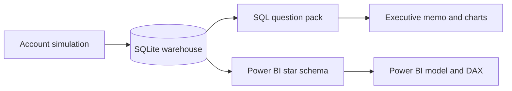

# Lumen Workspace — SaaS analytics

Subscription review for a fictional B2B product, closed through **September 2026**. The questions are the ones a revenue team actually argues about: did the existing book grow, which plan is leaking logos, whether low usage shows up before churn, and which acquisition channel is expensive for the retention it buys.

SQLite holds the warehouse. SQL answers the questions. Python checks the MRR bridge, draws the charts, and writes the memo. Power BI gets a star schema, DAX, and a build guide.

## Open the result

- [`outputs/executive_report.html`](outputs/executive_report.html)
- [`outputs/FINDINGS.md`](outputs/FINDINGS.md)
- `data/lumen.db`

```bash
sqlite3 data/lumen.db < sql/analysis/01_mrr_bridge.sql
```

Power BI Desktop does not run on macOS. The HTML memo is the report you can open here. [`powerbi/BUILD.md`](powerbi/BUILD.md) is the model: relationships, the measures, and the trap between monthly NRR and trailing-twelve-month NRR.

## Run it

```bash
cd lumen-saas-analytics
python3 -m venv .venv
source .venv/bin/activate
pip install -r requirements.txt
python run.py
python -m unittest discover -s tests -v
```

`python run.py` rebuilds `data/lumen.db` from seed 42, reruns `sql/analysis`, and rewrites the Power BI CSVs and the memo.

## How the pieces fit



| Path | What it is |
| --- | --- |
| `sql/01_schema.sql` | Plans, channels, accounts, subscription months, usage, tickets, spend |
| `sql/02_views.sql` | Subscription mart and the next-month churn flag |
| `sql/analysis/` | One business question per file |
| `src/generate.py` | Month-by-month simulation |
| `src/warehouse.py` | Load, then the bridge check |
| `src/analyze.py` | Charts, the fixed-cohort NRR, the memo |
| `powerbi/` | Build guide, DAX, theme, CSV extracts |
| `docs/` | Dictionary, definitions, methodology |

## Model choices worth keeping

- **The churn month is a row with MRR of zero.** Without it, churned dollars disappear and the bridge cannot tie.
- **Beginning MRR is `sum(prior_mrr)`.** New logos contribute zero, so you do not need a date offset to find the start of the month.
- **Expansion and contraction are the change, not the new MRR.** Summing `mrr` on expansion rows double-counts the book.
- **Do not count rows to count customers.** Churn rows are rows.
- **Monthly NRR and trailing-twelve-month NRR are different questions.** Monthly NRR is one month of movement over beginning MRR. Trailing-twelve-month NRR follows the accounts that were paying in October 2025 and values them in September 2026. The scorecard table is disconnected so a date slicer cannot silently change it.
- **Gross revenue retention caps each account at its starting MRR.** Otherwise expansion hides churn.
- **Month-6 retention drops cohorts that are not six months old.** A channel that just spent a lot of money would look perfectly retained.
- **Channel is a dimension. Industry is an attribute.** Marketing spend shares the channel. Nothing else shares industry.

Definitions: [`docs/metric-definitions.md`](docs/metric-definitions.md). What the simulator is allowed to bake in: [`docs/methodology.md`](docs/methodology.md).
